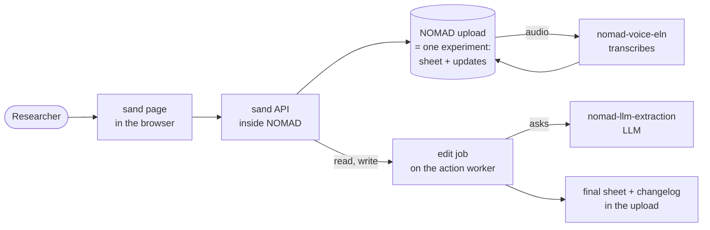

# sand

A voice and text assistant that keeps a lab's Excel sheet up to date.
Researchers say or type what changed during an experiment ("spin coating
speed is now 4000 for samples 1 to 3"); sand reads the sheet, works out
which cells the update means, and writes them once the researcher has
confirmed. The original file is never modified; the result is a new sheet
plus a changelog.

- **Start from a sheet**: upload the lab's batch sheet; it is checked and
  stored in NOMAD unchanged.
- **Record** spoken updates, with a live transcript while speaking.
- **Write** updates by hand.
- **Review** all updates of an experiment in the order they were made,
  correct their text, or delete one (its NOMAD entry and, for a recording,
  the audio).
- **Read**: as soon as an update is saved, an LLM turns it into cell
  edits. Every edit is shown and must be confirmed before it is written.
  An update the sheet cannot take (unknown sample, unknown column, a
  value of the wrong kind) is refused with the reason; sand never guesses.
- **Download** the edited sheet, or the original as it was uploaded, and
  read the changelog of what changed and why.
- **Voice mode**: start and stop recordings by voice, for work where the
  hands are not free (e.g. in a glove box).

## How it works



- An **experiment** is one NOMAD upload. It holds the uploaded sheet, an
  `InputCollection` entry and every recording (`AudioInput`) and note
  (`WrittenNote`) made for it. These entry types come from
  [`nomad-voice-eln`](https://github.com/FAIRmat-NFDI/nomad-voice-eln).
- sand does not transcribe or store anything itself: audio, transcripts
  and corrections live in the NOMAD entries; the sheets and the changelog
  are files of the upload.
- **Reading and writing** is one job, a NOMAD action on the action
  worker. The page starts it when an update is saved or revised, and
  again a moment after a confirmation. Updates are interpreted in time
  order against the sheet as the earlier confirmed updates left it. The
  LLM only proposes; deterministic checks decide whether a proposed edit
  fits the sheet, and nothing is written without a confirmation. The
  final sheet is rebuilt from the original every time, then verified
  cell by cell. An update the model already answered on the same sheet
  is replayed from its saved answer, not sent to the model again, so a
  run costs model calls only for updates that are new, reworded, or read
  a sheet an earlier confirmation changed.
- The time of an update is the time it was made and cannot be changed:
  the order of updates is the order they were made.

### The sheet

The sheet is the lab's batch sheet: one row per sample, one column per
value. Cell A1 is `Experiment Info`; the rest of row 1 holds the step
labels with their position (`1: Spin Coating`), row 2 the column
headers, samples start at row 3 with a `Sample` column. The upload is
refused, with each problem listed, when the sheet is not of this form:
no headers in row 2, merged cells below row 1, a step label without its
position, a column with values but no header, a sample row without a
sample name.

## Setup

sand is a **NOMAD plugin**, not a standalone app. It runs inside a NOMAD
instance; for development, use
[`nomad-distro-dev`](https://github.com/FAIRmat-NFDI/nomad-distro-dev).

### Requirements

Install these plugins in the same NOMAD:

- [`nomad-voice-eln`](https://github.com/FAIRmat-NFDI/nomad-voice-eln)
- [`nomad-llm-extraction`](https://github.com/FAIRmat-NFDI/nomad-llm-extraction)

API keys for the services the action worker calls:

- a [Groq](https://groq.com) key: transcription (Whisper)
- the key of the LLM provider of your `llm_model_name`, e.g. a Gemini key
- optional: a [Deepgram](https://deepgram.com) key for the live transcript
  while recording

### 1. Add sand to the distribution

From the root of `nomad-distro-dev`:

```sh
git submodule add https://github.com/FAIRmat-NFDI/sand.git packages/sand
uv add packages/sand
```

### 2. Configure `nomad.yaml`

`uv run poe setup` (step 3) creates `nomad.yaml` if it is missing. Enable
the entry points and set sand's options:

```yaml
plugins:
  entry_points:
    include:
      - sand.apis:sand_api
      - sand.actions.edit:edit_action_entry_point
      - nomad_gui.apis:gui_api
      - nomad_voice_eln.schema_packages:schema_package_entry_point
      - nomad_voice_eln.parsers:parser_entry_point
      - nomad_voice_eln.actions.transcribe:transcribe_action_entry_point
      - nomad_voice_eln.actions.record_note:record_note_action_entry_point
      - nomad_llm_extraction.actions:llm_extractor_action_entry_point
    options:
      sand.apis:sand_api:
        llm_model_name: 'gemini/gemini-2.5-flash'  # LiteLLM notation
        nomad_base_url: 'http://localhost:8000/nomad-oasis/api/v1'
        # live transcript while recording; optional, empty = off
        # (also read from DEEPGRAM_API_KEY)
        deepgram_api_key: '<your-deepgram-api-key>'
        deepgram_model: 'nova-3'
        # default of the "save live transcript" toggle
        # store_live_transcript: true
        launch_modes: ['tab']
```

`include` is a whitelist: every other plugin you use must be listed too.
The edit job runs on the CPU task queue of the action worker, like the
LLM action it calls.

> [!WARNING]
> Do not commit real API keys.

### 3. Start NOMAD

From the root of `nomad-distro-dev`:

```sh
uv run poe setup
docker compose up -d
uv sync
uv run poe start
```

In a second terminal, start the action worker. Transcription and the edit
job run there, so it needs the API keys:

```sh
export GROQ_API_KEY=<your-groq-key>       # transcription (Whisper)
export GEMINI_API_KEY=<your-gemini-key>   # the edit job; the key of your llm_model_name's provider
uv run poe cpuworker
```

Plugins load at startup: after a change to `nomad.yaml`, restart both.

### 4. Open sand

In the NOMAD GUI, go to *Dashboards* → sand. It opens in a new tab at
(trailing slash needed):

```
http://localhost:8000/nomad-oasis/dashboards/sand/
```

**Login:** sand has no login of its own. It uses the NOMAD GUI's, which
renews the login token while it is open. Keep a NOMAD GUI tab open in the
same browser; sand warns when the login is about to end.

## Using it

1. **New experiment** → choose the sheet (`.xlsx`), give the experiment a
   name, **Create from sheet**. A refused sheet lists its problems; fix
   the file and upload again. The name can be changed later with the
   pencil next to it in the header; the downloads follow it.
2. **Record** or **write** updates. Say or type one change at a time, with
   the step, the value and the samples it applies to. The updates appear
   on the right in the order they were made; a transcript can be
   corrected there.
3. Each update is **read** as soon as it is saved. Under it the page
   shows the edits it is ready to write, each with a **Confirm** button,
   and the reason for anything it could not place. A revised update is
   read again. Nothing is read while a recording is still being
   transcribed; a recording whose transcription failed has to be deleted
   first.
4. **Confirm** the edits that are right, one by one or all at once. They
   are written into the sheet a moment later; a confirmed update is a
   record and cannot be revised or deleted. A wrong reading is not
   confirmed: correct the update's text or add a new update.
5. **Download** the edited sheet (the original is a download too, under
   the file name it was uploaded with). The list under the summary names every
   edit written; the changelog, folded below it, holds every cell
   changed, the update it came from and who confirmed it.

**Read again** appears when a reading failed (for example when the LLM
could not be reached) and starts it once more.

Sheets and the changelog are files of the upload in NOMAD, so they can be
read there as well.

## Voice mode

Optional.

1. Select an experiment and click **Voice mode on**.
2. sand checks the experiment, the login, the recognizer and the microphone.
   When asked, say **"hey sand"** within 10 seconds; otherwise voice mode
   stays off and you can click again.
3. **Listening** is shown: voice mode is on.

Voice mode stays on until you click **Voice mode off** or leave or reload
the page. It does not turn itself off after some time, so turn it off when
the experiment is done. After a reload it is always off.

| To | Say |
|---|---|
| start a recording | **"hey sand, start record"** |
| stop and save it | **"hey sand, stop recording"** |

"hi sand" works too, and so do small variants ("start recording", "stop the
recording") and "please" ("hey sand, please stop recording", "hey sand, start
recording, please"). "stop" alone does nothing.

| Beep | Meaning |
|---|---|
| rising | recording runs |
| falling | recording stopped |
| one high tone | saved in NOMAD |
| two low tones | it failed; the screen says why |

No beep: the command was not understood, say it again.

**Tips**

- Pause briefly before and after a command. A command in the middle of a
  sentence is part of the note.
- Start speaking the update after the rising beep.
- A headset or clip-on microphone works much better than a laptop mic.
- The Record and Stop buttons keep working.
- English only.

**Privacy:** while voice mode is on, the microphone is always listening,
but only the speech recognizer in your browser hears it. The audio is
not saved on your computer and not sent anywhere, not even to NOMAD:
each piece of sound is checked for a command and then discarded. Only a
recording sends audio, to NOMAD (and to the live transcription, if it is
on), exactly as with the Record button. The browser shows its microphone
icon in the tab the whole time voice mode is on.

## Development

```sh
uv sync --all-extras
uv run pytest
node --test tests/js/*.test.mjs   # frontend logic, no dependencies
ruff check .
```
