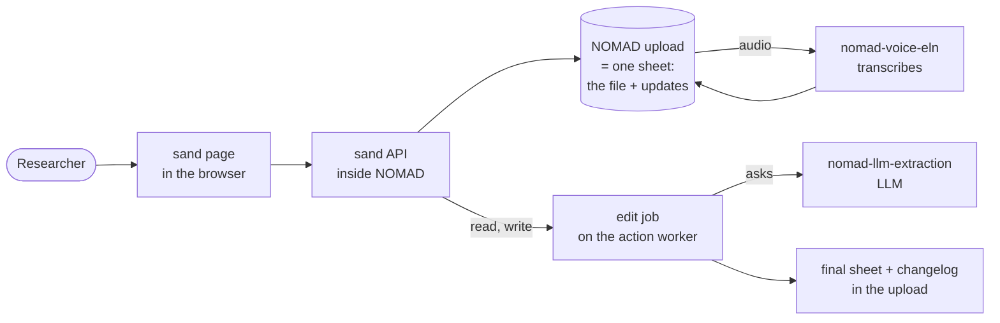

# sand

A voice and text assistant that keeps a lab's Excel sheet up to date.
Researchers say or type what changed during an experiment ("spin coating
speed is now 4000 for samples 1 to 3"); sand reads the sheet, works out
which cells the update means, and writes them once the researcher has
confirmed. The original file is never modified; the result is a new sheet
plus a changelog.

- **Start from a sheet**: upload the lab's batch sheet; it is checked and
  stored in NOMAD unchanged.
- **Record** spoken updates, with a live transcript while speaking.
- **Write** updates by hand.
- **Review** all updates of a sheet in the order they were made,
  correct their text, or delete one (its NOMAD entry and, for a recording,
  the audio).
- **Read**: as soon as an update is saved, an LLM turns it into cell
  edits. Every edit is shown and must be confirmed before it is written.
  An update the sheet cannot take (unknown sample, unknown column, a
  value of the wrong kind) is refused with the reason; sand never guesses.
- **Download** the edited sheet, or the original as it was uploaded; the
  changelog of what changed and why is stored beside them in the upload.
- **Voice mode**: start and stop recordings by voice, for work where the
  hands are not free (e.g. in a glove box).

## How it works



- A **sheet** is one NOMAD upload. It holds the uploaded file, an
  `InputCollection` entry and every recording (`AudioInput`) and note
  (`WrittenNote`) made for it. These entry types come from
  [`nomad-voice-eln`](https://github.com/FAIRmat-NFDI/nomad-voice-eln).
- sand does not transcribe or store anything itself: audio, transcripts
  and corrections live in the NOMAD entries; the sheets and the changelog
  are files of the upload.
- **Reading and writing** is one job, a NOMAD action on the action
  worker. The page starts it when an update is saved or revised, and
  again a moment after a confirmation. Updates are interpreted in time
  order against the sheet as the earlier confirmed updates left it. The
  LLM only proposes; deterministic checks decide whether a proposed edit
  fits the sheet, and nothing is written without a confirmation. The
  final sheet is rebuilt from the original every time, then verified
  cell by cell. An update the model already answered is replayed from
  its saved answer, not sent to the model again, while the values it
  names ("the DMSO", "from 3000") sit in the same cells; so a run costs
  model calls only for updates that are new, reworded, or that point at
  something an earlier update changed.
- The time of an update is the time it was made and cannot be changed:
  the order of updates is the order they were made.

### The sheet

The sheet is the lab's batch sheet: one row per sample, one column per
value. Cell A1 is `Experiment Info`; the rest of row 1 holds the step
labels with their position (`1: Spin Coating`), row 2 the column
headers, samples start at row 3 with a `Sample` column. The upload is
refused, with each problem listed, when the sheet is not of this form:
no headers in row 2, merged cells below row 1, a step label without its
position, a column with values but no header, a sample row without a
sample name.

## Setup

sand is a **NOMAD plugin**, not a standalone app: it runs inside a NOMAD
installation and is opened from NOMAD's *Dashboards*. Below: a local
NOMAD for trying it or developing, then what changes for an Oasis.

### What you need

| | What | Why |
|---|---|---|
| **Tools** | [git](https://git-scm.com), [uv](https://docs.astral.sh/uv/), [Docker](https://docs.docker.com/get-docker/) | NOMAD's development distribution uses them |
| **Plugins** | [`nomad-voice-eln`](https://github.com/FAIRmat-NFDI/nomad-voice-eln) | the entry types for sheets, recordings and notes; transcription. **Private repository**: ask for access |
| | [`nomad-llm-extraction`](https://github.com/FAIRmat-NFDI/nomad-llm-extraction), branch `enforceable-schema` | asks the LLM. Use the branch until [PR #13](https://github.com/FAIRmat-NFDI/nomad-llm-extraction/pull/13) is merged: it sends the provider a schema it can enforce |
| | [`nomad-gui`](https://pypi.org/project/nomad-gui/) (PyPI) | NOMAD's new GUI. sand has no login of its own: you log in there |
| **Keys** | the LLM provider's key, e.g. `GEMINI_API_KEY` | reading the updates (the edit job) |
| | `GROQ_API_KEY` ([Groq](https://groq.com)) | transcribing recordings (Whisper) |
| | optional: `DEEPGRAM_API_KEY` ([Deepgram](https://deepgram.com)) | the live transcript while recording. Without it there is none, but recordings are still transcribed (Groq) after they stop |
| **sand** | branch `kit_lab` | the sheet editor described here |

### 1. A local NOMAD with the plugins

```sh
git clone https://github.com/FAIRmat-NFDI/nomad-distro-dev.git
cd nomad-distro-dev

git submodule add -b kit_lab https://github.com/FAIRmat-NFDI/sand.git packages/sand
git submodule add https://github.com/FAIRmat-NFDI/nomad-voice-eln.git packages/nomad-voice-eln
git submodule add -b enforceable-schema https://github.com/FAIRmat-NFDI/nomad-llm-extraction.git packages/nomad-llm-extraction

uv add packages/sand packages/nomad-voice-eln packages/nomad-llm-extraction nomad-gui
```

`uv add` installs them editable: a code change needs a restart, not a
reinstall. The distribution's own README has the rest of its setup
(e.g. `uv run poe setup`, which writes a first `nomad.yaml`).

### 2. `nomad.yaml`

In the root of `nomad-distro-dev`. `include` is a whitelist: an entry
point that is not listed does not load, silently. Add every other plugin
you use as well.

```yaml
plugins:
  entry_points:
    include:
      # sand: the page and API, and the edit job
      - sand.apis:sand_api
      - sand.actions.edit:edit_action_entry_point
      # the new GUI, where you log in
      - nomad_gui.apis:gui_api
      # sheets, recordings, notes; transcription
      - nomad_voice_eln.schema_packages:schema_package_entry_point
      - nomad_voice_eln.parsers:parser_entry_point
      - nomad_voice_eln.actions.transcribe:transcribe_action_entry_point
      - nomad_voice_eln.actions.record_note:record_note_action_entry_point
      # the LLM call the edit job makes
      - nomad_llm_extraction.actions:llm_extractor_action_entry_point
    options:
      sand.apis:sand_api:
        # LiteLLM's name of the model; its provider's key goes to the worker
        llm_model_name: 'gemini/gemini-2.5-flash'
        # this NOMAD's API, as the server reaches it
        nomad_base_url: 'http://localhost:8000/nomad-oasis/api/v1'
        # optional, the live transcript while recording (Deepgram).
        # The key: DEEPGRAM_API_KEY where `poe start` runs (step 3), or
        # here as deepgram_api_key: '...' (then keep this file out of git).
        # No key = no live transcript; recordings are still transcribed.
        deepgram_model: 'nova-3'
        # default of the page's "save live transcript" toggle
        store_live_transcript: false
```

> [!WARNING]
> Keep keys out of `nomad.yaml` and out of git: set them in the
> environment of the process that uses them (step 3).

### 3. Start it

Each in its own terminal, from the root of `nomad-distro-dev`:

```sh
# 1. the databases (Elasticsearch, MongoDB, Temporal)
docker compose up -d

# 2. NOMAD itself: the API, the GUI and sand's page
export DEEPGRAM_API_KEY=...     # optional: the live transcript runs here
uv run poe start

# 3. the action worker: transcription, the edit job and its LLM calls
export GEMINI_API_KEY=...       # the key of llm_model_name's provider
export GROQ_API_KEY=...         # transcription
uv run poe cpuworker
```

All of sand's work runs as NOMAD actions on the CPU task queue, so this
one worker does it all; without it, nothing is read or transcribed.
Plugins load at start: after a change to `nomad.yaml` or to a plugin's
code, restart `poe start` and `poe cpuworker`.

### 4. Open sand

1. Log in to the new GUI: `http://localhost:8000/nomad-oasis/gui/v2/`.
   This sets the login cookie sand uses. Keep that tab open: it renews
   the login. (The classic GUI on port 3000 removes that cookie.)
2. Open sand: in the GUI, *Dashboards* → **SAND**, or directly
   `http://localhost:8000/nomad-oasis/dashboards/sand/` (with the
   trailing slash). It opens in its own tab.
3. Upload a sheet (see [Using it](#using-it)).

### In a NOMAD Oasis

The same, in your Oasis distribution (e.g. one made from
[`nomad-distro-template`](https://github.com/FAIRmat-NFDI/nomad-distro-template)):

- add sand, `nomad-voice-eln`, `nomad-llm-extraction` (with the branch
  above) and `nomad-gui` to the distribution's plugins, as git
  dependencies;
- the same `include` and `options` in its `nomad.yaml`, with
  `nomad_base_url` set to the Oasis' API, e.g.
  `https://your-oasis.example/nomad-oasis/api/v1`;
- the keys in the environment of the **CPU action worker** (LLM, Groq)
  and of the **app** (Deepgram), e.g. in `docker-compose.yaml`; make sure
  the CPU action worker runs.

### When something does not work

| You see | Check |
|---|---|
| no SAND under *Dashboards*, or 404 at `/dashboards/sand/` | `sand.apis:sand_api` in `include`; NOMAD restarted; the trailing slash |
| sand asks you to log in although you are | log in at `/gui/v2/` in the same browser, not the classic GUI |
| an update stays "Reading..." or "Waiting to be read" | the CPU worker runs (`poe cpuworker`), and has the LLM key; the Temporal UI at `http://localhost:8080` shows a failed job and why |
| a recording is never transcribed | `GROQ_API_KEY` on the worker; `nomad_voice_eln...transcribe_action_entry_point` in `include` |
| no live transcript while recording | `DEEPGRAM_API_KEY` where `poe start` runs; it is optional |
| "the sheet ..." when uploading | the sheet's form, see [The sheet](#the-sheet) |

## Using it

1. **Upload the sheet**: drop the `.xlsx` on the header (or **Choose a
   file**), give it a name, upload. A refused sheet lists its problems;
   fix the file and upload again. **Other sheets** opens one uploaded
   earlier; the pencil next to the name renames it.
2. **Record** or **write** updates: one change at a time, with the step,
   the value and the samples ("step 2 spin coating, rotation speed 4000
   for samples 1 to 3"). They appear on the right in the order they were
   made. A transcript can be corrected there.
3. Each update is **read** as soon as it is saved, against the sheet the
   updates above it leave. Under it: the edits it proposes (old → new,
   the samples), and in red what it could not place ("ambiguous",
   "disputed", "not found", "not applied", each with why). Nothing
   unclear is ever written. **Edits only** hides everything else.
4. **Decide**: every proposed edit is ticked. **Untick** a wrong one and
   say why; then **Recompute** reads the updates below it again without
   it. **Confirm all** writes the ticked edits into a copy of the sheet;
   those updates are then locked. **Reset all** takes every decision
   back and the sheet back to the original; the updates' words stay.
   **Read again** appears when a reading failed (e.g. the LLM could not
   be reached).
5. **Download** the edited sheet, or the original. The overview shows
   the sheet's steps, what varies between samples, and the cells the
   edits changed; the changelog in the upload lists every cell written,
   the update it came from and who confirmed it.

**Lab view** shows one step at a time with the recorder, for work at the
glove box.

## Voice mode

Optional.

1. Open a sheet and click **Turn voice mode on**.
2. sand checks the sheet, the login, the recognizer and the microphone.
   When asked, say **"hey sand"** within 10 seconds; otherwise voice mode
   stays off and you can click again.
3. **Listening** is shown: voice mode is on.

Voice mode stays on until you click **Turn voice mode off** or leave or reload
the page. It does not turn itself off after some time, so turn it off when
the work is done. After a reload it is always off.

| To | Say |
|---|---|
| start a recording | **"hey sand, start record"** |
| stop and save it | **"hey sand, stop recording"** |

"hi sand" works too, and so do small variants ("start recording", "stop the
recording") and "please" ("hey sand, please stop recording", "hey sand, start
recording, please"). "stop" alone does nothing.

| Beep | Meaning |
|---|---|
| rising | recording runs |
| falling | recording stopped |
| one high tone | saved in NOMAD |
| two low tones | it failed; the screen says why |

No beep: the command was not understood, say it again.

**Tips**

- Pause briefly before and after a command. A command in the middle of a
  sentence is part of the note.
- Start speaking the update after the rising beep.
- A headset or clip-on microphone works much better than a laptop mic.
- The Record and Stop buttons keep working.
- English only.

**Privacy:** while voice mode is on, the microphone is always listening,
but only the speech recognizer in your browser hears it. The audio is
not saved on your computer and not sent anywhere, not even to NOMAD:
each piece of sound is checked for a command and then discarded. Only a
recording sends audio, to NOMAD (and to the live transcription, if it is
on), exactly as with the Record button. The browser shows its microphone
icon in the tab the whole time voice mode is on.

## Development

```sh
uv sync --all-extras
uv run pytest
node --test tests/js/*.test.mjs   # frontend logic, no dependencies
ruff check .
```

### Measuring the reading against the real model

The tests run the sheet editor with canned model answers. Before a lab
relies on it, and after every change to the prompts or the model, it is
measured against the real model:

```sh
cd ~/fairmat/sand
~/fairmat/nomad-distro-dev/.venv/bin/python evals/sheet_edit/run_testcases.py
```

It runs with the distribution's Python, where the extraction engine is
installed; not `uv run` in the distribution, which may sync it. The key
comes from the shell (`GEMINI_API_KEY`).

`evals/sheet_edit/testcases.json` holds about forty instructions on the
synthetic sheet, each with the edits it must produce (column, samples,
value), the columns it must leave alone and the refusals it must say.
The script runs each through the same function, prompt and schema the
job uses, prints a line per case while it runs, then the cases that went
wrong with the preview the user would have seen, and the numbers the
plan gates on: precision of the ready edits (≥ 99 %), asked edits
proposed (≥ 95 %) or at least flagged (100 %), refusals said (100 %),
and the count of edits nobody asked for (0).

- `--only ID` runs one case.
- `--model NAME` asks another model; the default is the edit job's, read
  from the distribution's `nomad.yaml`.

Model answers are kept as `evals/sheet_edit/cache/<model>/<case id>.first.json`
and `.second.json`, one per pass. A file is reused while its model,
instruction and the prompt version (`PROMPT_VERSION` in `resolve.py`, bumped on every
prompt change) are the same; delete the folder for fresh answers.
The sheet they are asked about is written there too, as
`synthetic_sheet.xlsx`, to open next to them. The script never runs in CI; `tests/sheet_edit/test_testcases.py`
checks the cases and the judgement offline.

A second script measures the reuse of saved answers:

```sh
~/fairmat/nomad-distro-dev/.venv/bin/python evals/sheet_edit/run_chains.py
```

`evals/sheet_edit/chains.json` holds short stories: a few notes and the
clicks made on them (confirm, reject, undo, reword, delete, add). Each
story is played the way the edit job runs it, one job after every
click. Whenever a note reuses an answer read on another sheet, the model
is also asked fresh on the note's sheet. The two must make the same
edits (the gate, 100 %). The script also prints the readings the jobs
asked for, the readings reuse saved, and the notes read again although
their earlier answer made the same edits. Its answers are kept under
`evals/sheet_edit/cache/chains/<model>/`, one file per prompt and pass.
`--only ID` and `--model NAME` work as above; `tests/sheet_edit/test_chains.py`
checks the stories and the player offline.
